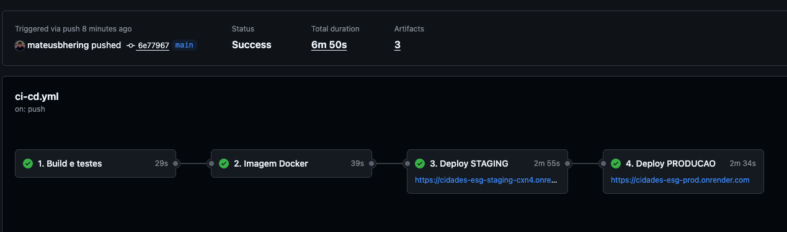
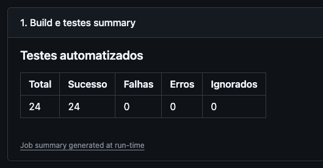
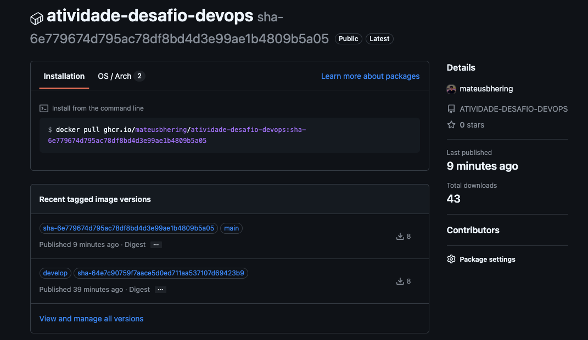
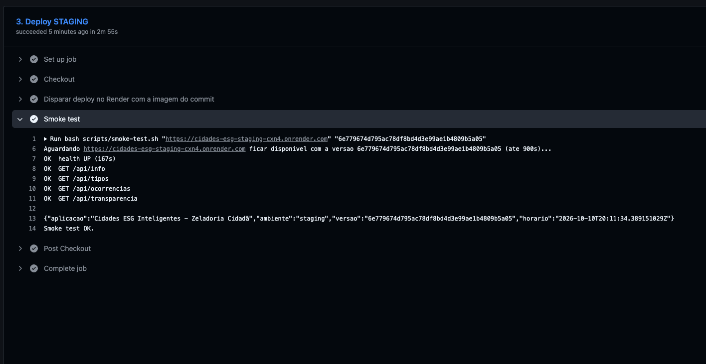
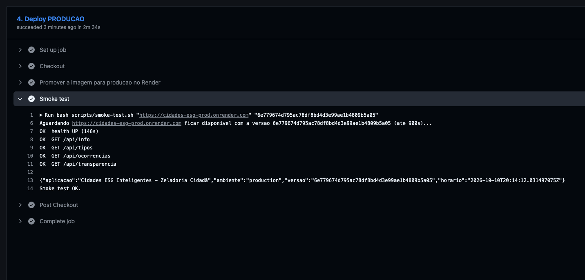
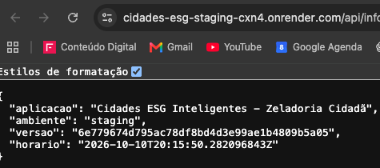
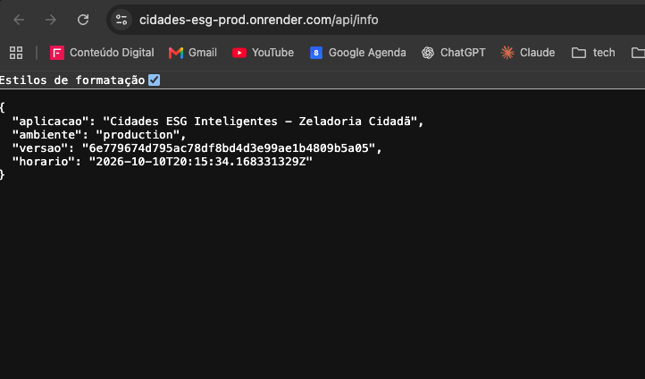
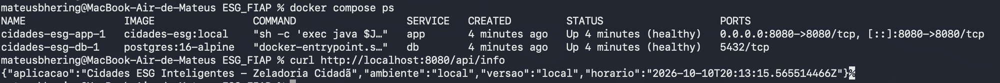
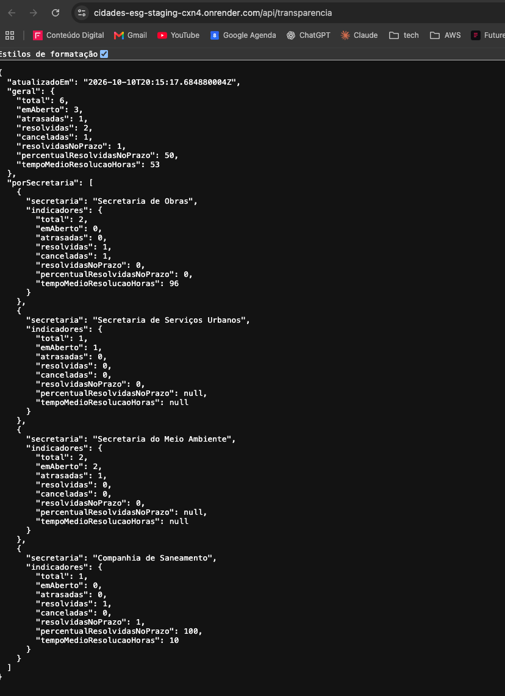

# Projeto - Cidades ESGInteligentes

## Zeladoria Cidadã

API REST em **Java Spring Boot** para o morador relatar problemas urbanos (buraco na via, poste apagado, descarte irregular de lixo, vazamento de água...) e acompanhar o atendimento pelo número de protocolo. Cada tipo de ocorrência tem uma **secretaria responsável** e um **prazo de atendimento**. A prefeitura avança as ocorrências por um fluxo de status controlado, e um **painel público de transparência** mostra, por secretaria, quantas foram resolvidas no prazo e o tempo médio de resolução.

| Pilar ESG | Como aparece no projeto |
|---|---|
| **Ambiental** | Ocorrências de descarte irregular, poda de árvores e vazamento de água (desperdício) |
| **Social** | Canal direto do cidadão com a prefeitura e prazos de atendimento que valem para todos os bairros |
| **Governança** | Fluxo auditável (datas de abertura, atendimento e encerramento com observação obrigatória) e painel público de desempenho |

O ciclo de vida da aplicação é automatizado com práticas DevOps: containerização com Docker, orquestração com Docker Compose e pipeline CI/CD no **GitHub Actions** com deploy em **staging** e **produção** no **Render**.

**Integrantes:**

- Mateus Bhering Beltrão Santos - RM564760
- Ariel Alves Amaral - RM564563
- Wesley Santos de França - RM563666
- Ronaldo dos Santos Silva - RM561414
- Rodrigo Kumamoto Rêgo - RM566049

| Ambiente | URL |
|---|---|
| Staging | `https://cidades-esg-staging-cxn4.onrender.com` |
| Produção | `https://cidades-esg-prod.onrender.com` |

### Regras de negócio

| Tipo de ocorrência | Secretaria responsável | Prazo |
|---|---|---|
| `BURACO_NA_VIA` | Secretaria de Obras | 72 h |
| `CALCADA_DANIFICADA` | Secretaria de Obras | 120 h |
| `ILUMINACAO_APAGADA` | Secretaria de Serviços Urbanos | 48 h |
| `DESCARTE_IRREGULAR` | Secretaria do Meio Ambiente | 72 h |
| `PODA_DE_ARVORE` | Secretaria do Meio Ambiente | 96 h |
| `VAZAMENTO_DE_AGUA` | Companhia de Saneamento | 24 h |

```
ABERTA ──► EM_ATENDIMENTO ──► RESOLVIDA
   │              │
   └──────────────┴─────────► CANCELADA
```

- O prazo é contado a partir da abertura. Uma ocorrência **ABERTA** ou **EM_ATENDIMENTO** com o prazo vencido aparece como `"atrasada": true`.
- Não é possível pular etapas (ex.: de ABERTA direto para RESOLVIDA) nem reabrir uma ocorrência encerrada. A API responde **409 Conflict**.
- Para **resolver** ou **cancelar**, é obrigatório informar uma observação.
- O cidadão recebe um protocolo no formato `ZEL-XXXXXXXX` e consulta a ocorrência por ele.

### Endpoints

| Método | Rota | Descrição |
|---|---|---|
| POST | `/api/ocorrencias` | Cidadão abre uma ocorrência e recebe o protocolo (201) |
| GET | `/api/ocorrencias/{protocolo}` | Acompanhar a ocorrência pelo protocolo |
| GET | `/api/ocorrencias?status=&tipo=&bairro=` | Listar, com filtros opcionais |
| GET | `/api/ocorrencias/atrasadas` | Pendentes com prazo vencido, das mais atrasadas para as menos |
| PATCH | `/api/ocorrencias/{protocolo}/status` | Secretaria muda o status (EM_ATENDIMENTO, RESOLVIDA, CANCELADA) |
| GET | `/api/transparencia` | Painel público: total, em aberto, atrasadas, % resolvidas no prazo e tempo médio, geral e por secretaria |
| GET | `/api/tipos` | Catálogo de tipos com secretaria e prazo |
| GET | `/` ou `/api/info` | Aplicação, ambiente (`staging`/`production`) e versão (commit) em execução |
| GET | `/actuator/health` | Health check |

Exemplos:

```bash
# abrir
curl -X POST http://localhost:8080/api/ocorrencias -H "Content-Type: application/json" \
  -d '{"tipo":"VAZAMENTO_DE_AGUA","descricao":"Agua escorrendo pela sarjeta","bairro":"Vila Nova","endereco":"Rua Sete, 88"}'

# iniciar atendimento e resolver (troque pelo protocolo recebido)
curl -X PATCH http://localhost:8080/api/ocorrencias/ZEL-XXXXXXXX/status -H "Content-Type: application/json" \
  -d '{"status":"EM_ATENDIMENTO"}'
curl -X PATCH http://localhost:8080/api/ocorrencias/ZEL-XXXXXXXX/status -H "Content-Type: application/json" \
  -d '{"status":"RESOLVIDA","observacao":"Tubulacao substituida"}'

# painel de transparencia
curl http://localhost:8080/api/transparencia
```

Com `APP_SEED=true` (padrão local e em staging), a aplicação cria 6 ocorrências fictícias (`ZEL-DEMO0001` a `ZEL-DEMO0006`) para o painel já começar com dados: duas resolvidas (uma no prazo e outra fora), uma em atendimento, uma atrasada, uma recente e uma cancelada.

---

## Como executar localmente com Docker

Pré-requisito: Docker Desktop (ou Docker Engine + plugin Compose). Não é preciso ter Java nem Maven instalados.

```bash
# 1. Criar o arquivo de variáveis a partir do modelo
cp .env.example .env            # no Windows (PowerShell): copy .env.example .env

# 2. Construir a imagem e subir aplicação + banco
docker compose up -d --build

# 3. Acompanhar os logs até aparecer "Started CidadesEsgApplication"
docker compose logs -f app

# 4. Testar
curl http://localhost:8080/api/info
curl http://localhost:8080/api/transparencia
bash scripts/smoke-test.sh http://localhost:8080

# 5. Parar (os dados continuam no volume pgdata)
docker compose down
# Parar e apagar os dados
docker compose down -v
```

### Simular staging e produção lado a lado na mesma máquina

O mesmo `docker-compose.yml` sobe ambientes isolados (containers, rede e volume próprios) trocando apenas o nome do projeto e o arquivo de variáveis:

```bash
docker compose -p esg-staging --env-file env/staging.env.example    up -d --build   # http://localhost:8081
docker compose -p esg-prod    --env-file env/production.env.example up -d --build   # http://localhost:8082
```

### Rodar os testes sem Docker (opcional)

Com Java 21 e Maven instalados: `mvn verify`. Os testes usam banco H2 em memória, então não precisam de PostgreSQL.

---

## Pipeline CI/CD

**Ferramentas:** GitHub Actions (orquestração do pipeline), Maven + JUnit 5 + Mockito (build e testes), Docker Buildx (imagem), GitHub Container Registry – GHCR (registro da imagem), Render (hospedagem dos ambientes staging e produção, com PostgreSQL gerenciado).

Arquivo: [`.github/workflows/ci-cd.yml`](.github/workflows/ci-cd.yml)

```
push develop ─┐
push main ────┼─► [1] Build e testes ─► [2] Imagem Docker ─► [3] Deploy STAGING ─► [4] Deploy PRODUÇÃO
pull request ─┘        (mvn verify)       (push GHCR)          + smoke test          + smoke test
                                                                                      (somente main)
```

| Etapa | Quando roda | O que faz |
|---|---|---|
| **1. Build e testes** | PR, `develop`, `main` | `mvn verify`: compila e roda os 24 testes (13 unitários das regras de negócio, sem banco, e 11 de integração da API com MockMvc + H2), publica os relatórios e o `.jar` como artefatos e escreve o resumo dos testes na página da execução. Se um teste falhar, o pipeline para aqui. |
| **2. Imagem Docker** | `develop`, `main` | Constrói a imagem pelo `Dockerfile` e publica no GHCR com duas tags: `sha-<commit>` (imutável) e o nome da branch. O commit é gravado na imagem (`APP_VERSION`). |
| **3. Deploy staging** | `develop`, `main` | `scripts/render-deploy.sh` chama o *deploy hook* do serviço de staging no Render passando a imagem exata (`imgURL=...:sha-<commit>`) e roda o `scripts/smoke-test.sh`, que espera o `/actuator/health` ficar `UP` e confere se `/api/info` já mostra a versão nova. |
| **4. Deploy produção** | somente `main`, após staging passar | Promove **a mesma imagem** testada em staging para produção e repete o smoke test. O environment `production` pode exigir aprovação manual. |

**Por que é seguro:** a imagem é construída uma única vez e promovida entre ambientes (o que foi validado em staging é exatamente o que vai para produção); produção só recebe deploy se build, testes, deploy de staging e smoke test de staging passarem.

### Configuração (feita uma vez)

1. **GitHub:** crie o repositório e envie o código para as branches `main` e `develop`. O primeiro push executa as etapas 1 e 2 e publica a imagem em `ghcr.io/<usuario>/<repositorio>`. As etapas de deploy vão falhar até o passo 4, o que é esperado.
2. **Imagem pública:** em *GitHub › seu perfil › Packages › (pacote) › Package settings*, mude a visibilidade para **Public** (ou cadastre no Render uma credencial do GHCR com um token `read:packages`).
3. **Render:**
   - Crie **um** PostgreSQL gratuito. Staging e produção usam o mesmo servidor, mas schemas separados (`esg_staging` e `esg_prod`), criados automaticamente pela aplicação.
   - Crie dois **Web Services › Existing Image** com a imagem `ghcr.io/<usuario>/<repositorio>:develop` (staging) e `...:main` (produção), plano Free, *Health Check Path* `/actuator/health`, com as variáveis:

     | Variável | Staging | Produção |
     |---|---|---|
     | `APP_ENV` | `staging` | `production` |
     | `DB_SCHEMA` | `esg_staging` | `esg_prod` |
     | `APP_SEED` | `true` | `false` |
     | `SPRING_DATASOURCE_URL` | `jdbc:postgresql://<host-interno>:5432/<banco>` | igual |
     | `SPRING_DATASOURCE_USERNAME` / `SPRING_DATASOURCE_PASSWORD` | dados do Postgres | igual |

   - Em cada serviço, copie o **Deploy Hook** (*Settings › Deploy Hook*).
4. **GitHub › Settings › Environments:** crie `staging` e `production`. Em cada um, adicione o secret `RENDER_DEPLOY_HOOK` (hook do serviço correspondente) e a variável `APP_URL` (URL pública do serviço). Opcional: em `production`, ative *Required reviewers* para exigir aprovação antes do deploy.
5. Em *Actions*, rode novamente o workflow (ou faça um novo push).

---

## Containerização

### Dockerfile

```dockerfile
# syntax=docker/dockerfile:1

# ---------- Estagio 1: build ----------
# Imagem com Maven + JDK 21 apenas para compilar e empacotar o .jar
FROM maven:3.9-eclipse-temurin-21 AS build
WORKDIR /app

# Copia so o pom.xml primeiro: as dependencias ficam em cache enquanto o pom nao mudar
COPY pom.xml .
RUN mvn -B -q dependency:go-offline

COPY src ./src
# Os testes rodam em uma etapa propria do pipeline, por isso sao pulados aqui
RUN mvn -B -q package -DskipTests

# ---------- Estagio 2: runtime ----------
# Imagem final enxuta: apenas o JRE (sem Maven, sem codigo-fonte)
FROM eclipse-temurin:21-jre-alpine

# Versao (commit) gravada na imagem pelo pipeline e exibida em /api/info
ARG APP_VERSION=dev
ENV APP_VERSION=${APP_VERSION} \
    JAVA_OPTS="-XX:MaxRAMPercentage=75"

WORKDIR /app

# Usuario sem privilegios de root
RUN addgroup -S esg && adduser -S esg -G esg
COPY --from=build /app/target/cidades-esg.jar app.jar
USER esg

EXPOSE 8080

HEALTHCHECK --interval=30s --timeout=5s --start-period=60s --retries=3 \
  CMD wget -qO- "http://localhost:${PORT:-8080}/actuator/health" || exit 1

ENTRYPOINT ["sh", "-c", "exec java $JAVA_OPTS -jar app.jar"]
```

### Estratégias adotadas

- **Multi-stage build:** o estágio de build usa a imagem do Maven; a imagem final leva só o JRE Alpine e o `.jar`, ficando bem menor e sem ferramentas de compilação.
- **Cache de camadas:** o `pom.xml` é copiado antes do código, então as dependências só são baixadas de novo quando o `pom.xml` muda. No pipeline, o cache do Buildx fica no GitHub Actions (`type=gha`).
- **Segurança:** a aplicação roda com um usuário sem privilégios (`esg`), e o `.dockerignore` impede que `.env`, `.git` e `target/` entrem na imagem.
- **Configuração por ambiente:** nada é fixo na imagem; banco, ambiente e schema vêm de variáveis de ambiente, e a mesma imagem roda em local, staging e produção. A porta segue a variável `PORT` exigida pelo Render.
- **Memória:** `-XX:MaxRAMPercentage=75` faz a JVM respeitar o limite de memória do container (512 MB no plano gratuito do Render).
- **Health check:** o Docker verifica `/actuator/health` periodicamente.
- **Rastreabilidade:** o commit fica gravado na imagem e aparece em `/api/info`.

### Orquestração (docker-compose.yml)

- **Serviços:** `app` (API) e `db` (PostgreSQL 16).
- **Volume:** `pgdata` guarda os dados do banco entre reinícios.
- **Rede:** `esg-net` (bridge) isola a comunicação; a API acessa o banco pelo nome `db`.
- **Variáveis de ambiente:** lidas do `.env` (modelo em `.env.example`); a senha do banco é obrigatória.
- **Ordem de subida:** `depends_on` com `condition: service_healthy` faz a API esperar o `pg_isready` do banco.

---

## Prints do funcionamento

> Salve os prints na pasta `docs/prints/` com os nomes abaixo; eles aparecem aqui automaticamente no GitHub.

| # | Evidência | Arquivo |
|---|---|---|
| 1 | Execução completa do pipeline (4 jobs verdes) | `docs/prints/01-pipeline-geral.png` |
| 2 | Job de build e testes com o resumo dos testes (24 testes, 0 falhas) | `docs/prints/02-build-testes.png` |
| 3 | Imagem publicada no GHCR | `docs/prints/03-imagem-ghcr.png` |
| 4 | Job de deploy em staging com smoke test OK | `docs/prints/04-deploy-staging.png` |
| 5 | Job de deploy em produção com smoke test OK | `docs/prints/05-deploy-producao.png` |
| 6 | `/api/info` em staging (`"ambiente":"staging"`) | `docs/prints/06-staging-api-info.png` |
| 7 | `/api/info` em produção (`"ambiente":"production"`) | `docs/prints/07-producao-api-info.png` |
| 8 | `docker compose ps` e API respondendo localmente | `docs/prints/08-docker-compose-local.png` |
| 9 | `/api/transparencia` em staging com os dados de demonstração | `docs/prints/09-staging-transparencia.png` |











Links: [execução do pipeline](https://github.com/mateusbhering/ATIVIDADE-DESAFIO-DEVOPS/actions) · [staging](https://cidades-esg-staging-cxn4.onrender.com/api/info) · [produção](https://cidades-esg-prod.onrender.com/api/info)

---

## Tecnologias utilizadas

- **Linguagem e framework:** Java 21, Spring Boot 3.3 (Web, Data JPA, Validation, Actuator)
- **Banco de dados:** PostgreSQL 16 (local e Render) e H2 em memória (testes)
- **Build e testes:** Maven, JUnit 5, Mockito, Spring MockMvc, AssertJ (prazos testados com `java.time.Clock` fixo)
- **Containers:** Docker (multi-stage), Docker Compose
- **CI/CD:** GitHub Actions, GitHub Container Registry (GHCR), GitHub Environments
- **Hospedagem:** Render (Web Services por imagem + PostgreSQL gerenciado)
- **Scripts:** Bash (`scripts/smoke-test.sh` e `scripts/render-deploy.sh`)

---

## Estrutura do projeto

```
cidades-esg-zeladoria/
├── .github/workflows/ci-cd.yml    # pipeline CI/CD
├── Dockerfile                     # imagem multi-stage
├── docker-compose.yml             # app + PostgreSQL, volume e rede
├── .env.example                   # modelo de variáveis (local)
├── env/                           # variáveis para simular staging e produção
├── scripts/smoke-test.sh          # verificação pós-deploy
├── scripts/render-deploy.sh       # dispara o deploy no Render com a imagem do commit
├── src/main/java/.../model        # Ocorrencia, tipos, secretarias e fluxo de status
├── src/main/java/.../dto          # requisições e respostas da API
├── src/main/java/.../config        # relógio e dados de demonstração (APP_SEED)
├── src/main/java/.../service      # casos de uso e cálculo do painel de transparência
├── src/main/java/.../controller   # endpoints REST
├── src/test/java/...              # 13 testes unitários e 11 de integração
├── docs/prints/                   # prints do funcionamento
├── Documentacao-Cidades-ESG.docx  # documentação técnica (exportar para PDF)
└── README.md
```

---

## Checklist de entrega

| Item | Status |
|---|---|
| Projeto compactado em .ZIP com estrutura organizada | ☑ |
| Dockerfile funcional | ☑ |
| docker-compose.yml ou arquivos Kubernetes | ☑ |
| Pipeline com etapas de build, teste e deploy | ☑ |
| README.md com instruções e prints | ☐ (adicionar prints em `docs/prints/`) |
| Documentação técnica com evidências (PDF ou PPT) | ☐ (gerar novamente o PDF após incluir os prints) |
| Deploy realizado nos ambientes staging e produção | ☐ (após configurar Render e GitHub) |
